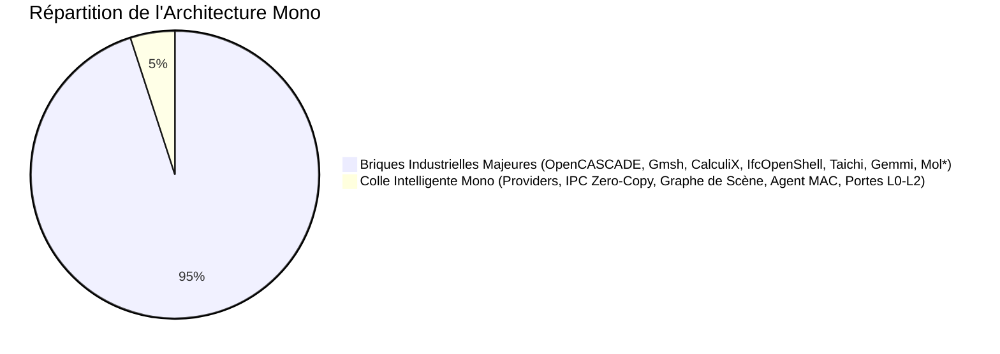
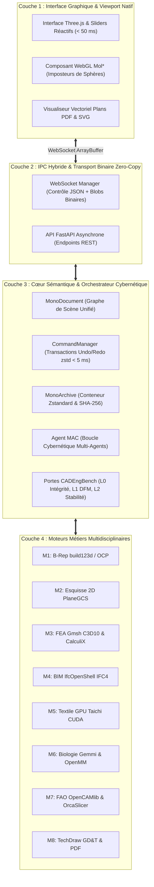
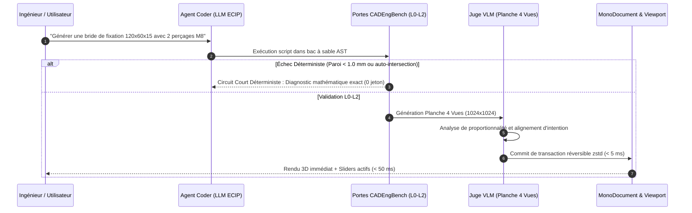

<div align="center">

# 💎 Mono CAD Studio v3.0 Enterprise
### **Environnement d'Ingénierie Multidisciplinaire Unifié Piloté par Intelligence Artificielle**
#### *De la Macromolécule Atomique ($10^{-9}\text{ m}$) à l'Architecture Bâtiment ($10^{2}\text{ m}$)*

[](file:///tests)
[](file:///src/mono)
[](pyproject.toml)
[](frontend/src/main.ts)
[](file:///bin)
[](src/mono)
[](LICENSE)

<br/>

```
       ┌────────────────────────────────────────────────────────────────┐
       │     NANO (10⁻⁹ m)  ◄───  MILLI (10⁻³ m)  ───►  METER (10² m)   │
       │   [Biologie Mol*]       [Mécanique & CAM]       [BIM IFC4]     │
       └────────────────────────────────────────────────────────────────┘
```

</div>

---

## 📑 Sommaire
1. [Vue d'Ensemble & Vision Système](#1-vue-densemble--vision-système)
2. [Les Huit Invariants Architecturaux Inviolables](#2-les-huit-invariants-architecturaux-inviolables)
3. [Architecture Système en Quatre Couches](#3-architecture-système-en-quatre-couches)
4. [Galerie Algorithmique des Huit Moteurs Métiers](#4-galerie-algorithmique-des-huit-moteurs-métiers)
   - 4.1 [Moteur 1 : CAO B-Rep Déclarative & Paradigme ECIP (build123d / OCP)](#41-moteur-1--cao-b-rep-déclarative--paradigme-ecip)
   - 4.2 [Moteur 2 : Esquisse 2D Paramétrique Contrainte (PlaneGCS / QR DOF)](#42-moteur-2--esquisse-2d-paramétrique-contrainte)
   - 4.3 [Moteur 3 : Simulation FEA Mécanique & CFD (Gmsh C3D10 / CalculiX / OpenFOAM)](#43-moteur-3--simulation-fea-mécanique--cfd)
   - 4.4 [Moteur 4 : Architecture & BIM Paramétrique (IfcOpenShell IFC4 / HLR 2D)](#44-moteur-4--architecture--bim-paramétrique)
   - 4.5 [Moteur 5 : Textile & Matériaux Souples sur GPU (Taichi XPBD / SDF 3D)](#45-moteur-5--textile--matériaux-souples-sur-gpu)
   - 4.6 [Moteur 6 : Biologie Macromoléculaire Cristallographique (Gemmi / Mol* / OpenMM)](#46-moteur-6--biologie-macromoléculaire-cristallographique)
   - 4.7 [Moteur 7 : Fabrication Assistée par Ordinateur (OpenCAMlib / GRBL / OrcaSlicer)](#47-moteur-7--fabrication-assistée-par-ordinateur)
   - 4.8 [Moteur 8 : Dessin Industriel Normalisé & Tolérancement GD&T (ISO 7200 / ASME Y14.1)](#48-moteur-8--dessin-industriel-normalisé--tolérancement-gdt)
5. [Le Format Conteneur Unifié d'Archive `.mono`](#5-le-format-conteneur-unifié-darchive-mono)
6. [La Boucle Cybernétique Multi-Agents (MAC) & Portes CADEngBench](#6-la-boucle-cybernétique-multi-agents-mac--portes-cadengbench)
7. [Installation & Démarrage Rapide (100% Natif)](#7-installation--démarrage-rapide-100-natif)
8. [Matrice des Endpoints API REST & IPC Binaire Zero-Copy](#8-matrice-des-endpoints-api-rest--ipc-binaire-zero-copy)
9. [Gouvernance des Licences & Bouclier Anti-GPL](#9-gouvernance-des-licences--bouclier-anti-gpl)
10. [Validation de la Suite de Tests & Couverture](#10-validation-de-la-suite-de-tests--couverture)

---

## 1. Vue d'Ensemble & Vision Système

**Mono CAD Studio** est la première plateforme d'ingénierie multidisciplinaire unifiée conçue pour fusionner dans une même scène physique continue :
- La **CAO mécanique solide analytique** (B-Rep exact ISO 10303 STEP),
- L'**architecture numérique du bâtiment** (BIM IFC4 ISO 16739),
- La **physique des éléments finis** (FEA linéaire & non linéaire, contraintes de Von Mises),
- La **simulation de matériaux souples temps réel sur GPU** (Textile XPBD à 60 FPS),
- La **cristallographie macromoléculaire** (Protéines PDB/mmCIF, BinaryCIF et dynamique moléculaire),
- La **fabrication assistée par ordinateur** (Usinage CNC 3/5 axes avec G-code universel et tranchage FDM).

### 🏛️ Le Principe des 95 % / 5 %
> **L'ingénierie moderne de pointe ne réinvente pas la roue** : elle assemble avec une rigueur mathématique absolue **95 % de briques géantes open source industrielles déjà éprouvées** (OpenCASCADE, Gmsh, CalculiX, IfcOpenShell, Taichi, Gemmi, Mol\*, OpenCAMlib), reliées par **5 % de colle logicielle intelligente, typée et hautement sécurisée**.



---

## 2. Les Huit Invariants Architecturaux Inviolables

Mono repose sur huit principes fondamentaux garantissant sa pérennité et sa robustesse industrielle :

1. **Source Unique de Vérité (`MonoDocument`) :** Tout l'état géométrique, physique et sémantique réside dans un graphe de scène hiérarchique orienté acyclique inspiré d'OpenUSD. Aucune géométrie n'est dupliquée inutilement.
2. **Exécution 100 % Native (Strictement Zéro Docker) :** Tout s'exécute nativement sous Windows, Linux et macOS via l'environnement ultra-rapide `uv`, éliminant les surcharges mémoires et les lenteurs de virtualisation.
3. **Typage Fort Absolu (Politique Zéro `any`) :** Aucun `any` ou `Any` toléré tant en Python (mypy strict, `numpy.typing`) qu'en TypeScript.
4. **Réversibilité Transactionnelle Instantanée (< 5 ms) :** Toute mutation transite par le patron `Command` avec instantanés différentiels compressés sous **Zstandard** (`zstd`), permettant l'Undo/Redo sans recalcul géométrique lourd.
5. **Double Verrou Déterministe & Multimodal :** Validation en circuit court sans IA via les portes géométriques déterministes **CADEngBench (L0-L2)**, puis inspection visuelle par juge VLM sur planche composite 4 vues cotée.
6. **Manipulation Directe Découplée (< 50 ms) :** Les dimensions clés extraites du script paramétrique alimentent des curseurs (*sliders*) dans l'interface, recalculant la forme et re-tessellant le solide sans aucun appel au modèle de langage.
7. **Barrière Juridique d'Isolation Anti-GPL (GPL Shield) :** Les solveurs sous licence copyleft (CalculiX GPLv2, Gmsh binaire GPLv2+, OpenFOAM GPLv3) sont strictement confinés dans des sous-processus isolés avec échange par fichiers standardisés, préservant la licence permissive libre (**Apache-2.0 / MIT**) du cœur de Mono.
8. **Précision Relative-au-Centre (Rendu Multi-Échelle RTC) :** Coordonnées mondiales en double précision `float64` CPU (mètres) et coordonnées de sommets relatives `float32` GPU, éliminant tout tremblement numérique (*vertex jittering*) de l'atome ($10^{-9}\text{ m}$) au bâtiment ($10^{2}\text{ m}$).

---

## 3. Architecture Système en Quatre Couches



---

## 4. Galerie Algorithmique des Huit Moteurs Métiers

### 4.1 Moteur 1 : CAO B-Rep Déclarative & Paradigme ECIP
- **Noyau :** `build123d 0.13+` sur `OpenCASCADE 7.8 (OCP)`.
- **Paradigme ECIP (*Explicit Context Imperative Paradigm*) :** Context managers Python stricts et bac à sable de sécurité AST éliminant tout risque d'exécution arbitraire (`SecurityASTValidator`).
- **Gestion des singularities géométriques :** Micro-dépassement automatique ($\Delta z = 0.1\text{ mm}$) sur perçages soustractifs et filtre de sécurité de congé analytique :
  $$\forall e \in \text{Edges}, \quad \text{Fillet}(e, R) \iff \text{Length}(e) \ge 2.2 \times R$$

```python
import build123d as bd

with bd.BuildPart() as builder:
    bd.Box(100.0, 50.0, 15.0)
    top_face = builder.faces().sort_by(bd.Axis.Z)[-1]
    with bd.BuildSketch(top_face):
        bd.Circle(radius=6.0)
    bd.Extrude(amount=-15.0, mode=bd.Mode.SUBTRACT)

result = builder.part
```

---

### 4.2 Moteur 2 : Esquisse 2D Paramétrique Contrainte
- **Solveur :** Algorithme non-linéaire de Powell DogLeg et Levenberg-Marquardt (`PlaneGCS`).
- **Calcul exact des Degrés de Liberté (`dof`) par Décomposition QR :**
  $$\mathbf{J} \mathbf{P} = \mathbf{Q} \mathbf{R} = \mathbf{Q} \begin{pmatrix} \mathbf{R}_{11} & \mathbf{R}_{12} \\ \mathbf{0} & \mathbf{0} \end{pmatrix} \implies \text{dof} = n - \text{rank}(\mathbf{J})$$
  - $\text{dof} = 0$ : Esquisse iso-contrainte résolue.
  - $\text{dof} > 0$ : Esquisse sous-contrainte (surbrillance bleue des degrés résiduels).
  - Décomposition SVD pour isoler et afficher en rouge les contraintes contradictoires ou redondantes.
- **Exports :** Vectoriel SVG et CAO AutoCAD DXF R12 avec calques géométriques normalisés.

---

### 4.3 Moteur 3 : Simulation FEA Mécanique & CFD
- **Défeaturisation B-Rep Intelligente :** Suppression automatique des micro-détails esthétiques via `BRepAlgoAPI_Defeaturing` prévenant l'explosion inutile du nombre de nœuds.
- **Maillage Volumique Quadratique C3D10 (Taylor-Hood) sous Gmsh :**
  Éléments tétraédriques à **10 nœuds** (4 sommets + 6 nœuds milieux) avec polynômes d'interpolation de degré 2 :
  $$\mathbf{u}(\xi, \eta, \zeta) = \sum_{i=1}^{10} N_i(\xi, \eta, \zeta) \mathbf{u}_i$$
  *Élimine le verrouillage artificiel en cisaillement (shear locking) propre aux éléments linéaires C3D4.*
- **Résolution Statique Linéaire CalculiX (`ccx.exe`) :**
  $$\mathbf{K} \mathbf{U} = \mathbf{F}$$
  Calcul du champ de contraintes équivalentes de Von Mises :
  $$\sigma_{\text{VM}} = \sqrt{\frac{1}{2}\left[(\sigma_{xx}-\sigma_{yy})^2 + (\sigma_{yy}-\sigma_{zz})^2 + (\sigma_{zz}-\sigma_{xx})^2 + 6(\tau_{xy}^2 + \tau_{yz}^2 + \tau_{zx}^2)\right]}$$
  Diffusion temps réel sous forme de champ scalaire normalisé projeté dans Three.js (palette Viridis).
- **Aérodynamique & CFD OpenFOAM :** Préparation modulaire des dictionnaires `blockMesh`, `snappyHexMesh` et solveur incompressible `simpleFoam`.

---

### 4.4 Moteur 4 : Architecture & BIM Paramétrique
- **Norme Internationale :** IFC4 (ISO 16739-1) via `IfcOpenShell 0.9`.
- **Structure Spatiale Hiérarchique buildingSMART :**
  $$\text{IfcProject} \longrightarrow \text{IfcSite} \longrightarrow \text{IfcBuilding} \longrightarrow \text{IfcBuildingStorey}$$
- **Éléments Métiers Sémantiques :** Murs (`IfcWallStandardCase`), dalles (`IfcSlab`), poteaux (`IfcColumn`), poutres (`IfcBeam`), fenêtres et toits avec profilés matières et jeux de propriétés standardisés (`Pset_WallCommon`).
- **Coupes 2D d'Étage Automatiques (HLR) :** Extraction de plans de coupe horizontaux à $z = +1.20\text{ m}$ du niveau fini via l'algorithme `HLRBRep_Algo` pour export PDF et DXF.

---

### 4.5 Moteur 5 : Textile & Matériaux Souples sur GPU
- **Solveur XPBD GPU Natif (Taichi Lang sur CUDA RTX 3050) :**
  Formulation variationnelle de Macklin 2016 à conformité inverse normalisée par le sous-pas temporel :
  $$\tilde{\alpha}_j = \frac{\alpha_j}{\Delta t^2}, \quad \Delta \lambda_j = \frac{-\mathcal{C}_j(\mathbf{x}) - \tilde{\alpha}_j \lambda_j}{\nabla \mathcal{C}_j(\mathbf{x}) \mathbf{M}^{-1} \nabla \mathcal{C}_j(\mathbf{x})^T + \tilde{\alpha}_j}$$
  $$\Delta \mathbf{x} = \mathbf{M}^{-1} \nabla \mathcal{C}_j(\mathbf{x})^T \Delta \lambda_j$$
- **Contraintes Physiques Mixtes :** Élongation, cisaillement et flexion dièdre isométrique (*Isometric Bending* $\mathcal{C}_{\text{bend}} = \arccos(\mathbf{n}_1 \cdot \mathbf{n}_2) - \theta_0$).
- **Collisions Mixtes Tissu / Solide B-Rep par Champ de Distance Signé (SDF 3D) :**
  La géométrie B-Rep est voxelisée en texture 3D de distance signée $\Phi(\mathbf{x})$. Pour tout nœud de tissu avec $\Phi(\mathbf{x}_i) < r_{\text{textile}}$ :
  $$\mathbf{x}_i \leftarrow \mathbf{x}_i + \left(r_{\text{textile}} - \Phi(\mathbf{x}_i)\right) \nabla \Phi(\mathbf{x}_i)$$
  Garantit une cadence constante de **60 FPS sans interpénétration**.

---

### 4.6 Moteur 6 : Biologie Macromoléculaire Cristallographique
- **Ingestion C++ Ultrarapide :** Parsing cristallographique complet des fichiers `.pdb`, `.cif` et `.mmcif` via `gemmi`.
- **Conversion Binaire Haute Densité (BinaryCIF `.bcif`) :** Réduction de 85 % de la charge réseau via compression delta d'entiers et bit-packing.
- **Rendu WebGL par Quads d'Imposteurs de Sphères :**
  Calcul analytique de la profondeur dans le fragment shader de Three.js :
  $$z_{\text{frag}} = z_{\text{centre}} \pm \sqrt{R^2 - (x^2 + y^2)}$$
  Permet d'afficher simultanément plus de 500 000 atomes avec surfaces de solvant (SAS) et rubans secondaires (*Cartoon*) à 60 FPS.
- **Dynamique Moléculaire OpenMM :** Minimisation d'énergie et intégration de trajectoires avec champ de force AMBER14.

---

### 4.7 Moteur 7 : Fabrication Assistée par Ordinateur
- **Usinage CNC Soustractif (`OpenCAMlib`) :**
  - Outils hémisphériques (*Ball*), cylindriques plats (*Endmill*) et toroïdaux (*Bullnose*).
  - Trajectoires Drop-Cutter 3D, passes de finition à hauteur de crête constante (*Constant Scallop*), ébauche adaptative 2.5D et contournage avec compensation de rayon.
  - **Post-Processeur Universel Multi-DCN :** Génération de G-code certifié pour **GRBL** (routeurs & CNC d'atelier), **Fanuc 31i**, **Siemens 840D**, **Heidenhain TNC 640**, **Haas NGC** et **LinuxCNC**.
  - Vérification volumique anti-collision outil/brut (*anti-gouging*).
- **Fabrication Additive (Tranchage FDM OrcaSlicer CLI) :**
  - Invocation sans tête en sous-processus isolé.
  - Hauteurs de couches adaptatives (0.08 à 0.28 mm) selon la courbure locale, génération de supports et formats d'échange `.3mf` / `.gcode`.

---

### 4.8 Moteur 8 : Dessin Industriel Normalisé & Tolérancement GD&T
- **Élimination Rigoureuse des Lignes Cachées (HLR) :**
  Projection orthographique selon la norme ISO 128 avec séparation stricte des arêtes :
  - *Arêtes Visibles* : Traits continus épais (0.45 mm).
  - *Arêtes Cachées* : Traits tiretés fins (0.25 mm).
- **Cotation Associative & Tolérancement GD&T (ISO 1101 / ASME Y14.5) :**
  - Flèches pleines vectorielles, lignes de rappel et cotes linéaires/diamètres.
  - Cadres de contrôle géométrique normalisés (Planéité `[-]`, Parallélisme `//`, Perpendicularité `_|_`, Localisation `(+)`, Coaxialité `((O))`, État au Maximum de Matière `(M)`).
- **Cartouche d'Ingénierie ISO 7200 / ASME Y14.1 & Rendu Vectoriel PDF :**
  Compilé directement par le moteur vectoriel pur-Python `fpdf2` avec échelle, révision, matière, projection européenne et tolérances générales ISO 2768-mK.

---

## 5. Le Format Conteneur Unifié d'Archive `.mono`

Le conteneur `.mono` est une archive d'ingénierie universelle, auto-suffisante, compressée en **Zstandard (niveau 3)** avec somme de contrôle d'intégrité **CRC32 de trame** et hachages cryptographiques **SHA-256** par artefact :

```text
projet_industriel.mono (Archive compressée zstd)
│
├── manifest.json                  # Manifeste d'ingénierie horodaté, paramètres et SHA-256
├── brep/                          # Géométries exactes B-Rep au standard STEP (ISO 10303-21)
│   └── bracket.step
├── bim/                           # Maquette architecturale normalisée IFC4
│   └── building.ifc
├── fea/                           # Maillages éléments finis Gmsh volumiques C3D10
│   └── structure.msh
├── cam/                           # Programmes d'usinage CNC ISO 6983 (Fanuc & GRBL)
│   ├── milling.gcode
│   └── milling_grbl.gcode
├── bio/                           # Macromolécules cristallographiques CIF et BinaryCIF
│   ├── 1crn.cif
│   └── 1crn.bcif
├── textile/                       # Propriétés physiques et maillages de tissu XPBD
│   └── drape.json
├── slicer/                        # G-code et métriques d'impression additive 3D
│   └── additive.gcode
└── techdraw/                      # Plans techniques d'atelier cotés normalisés
    ├── drawing.svg
    ├── drawing.dxf
    └── drawing.pdf
```

### Extrait du Manifeste Sémantique (`manifest.json`)
```json
{
  "format": "mono-archive",
  "schema_version": "1.0.0",
  "created_at": "2026-10-25T14:00:00Z",
  "author": "Brandon (jbrandonp)",
  "title": "Support Robotique Unifié",
  "version": "2.0",
  "units": "mm",
  "parameters": {
    "length": { "value": 120.0, "min": 20.0, "max": 300.0, "unit": "mm", "label": "Longueur" }
  },
  "entities": [
    {
      "entity_id": "bracket_brep",
      "provider_name": "brep_build123d",
      "scale_domain": "milli",
      "file_path": "brep/bracket.step",
      "sha256": "8a35b1d982ec45c0a1b2d4f3e6a9c1e7a5d3f2b1c4e6a8d0b2c4e6f8a0d2b4c6",
      "size_bytes": 145020
    }
  ]
}
```

---

## 6. La Boucle Cybernétique Multi-Agents (MAC) & Portes CADEngBench

Mono intègre un orchestrateur multi-agents autonome capable de générer et modifier du code CAO paramétrique à travers deux circuits de rétroaction :



### Matrice des Portes Mathématiques Déterministes (CADEngBench)
| Porte | Intitulé | Critères Mathématiques Inviolables |
|---|---|---|
| **Porte L0** | **Intégrité B-Rep Manifold** | `BRepCheck_Analyzer.IsValid() == True` ; Volume $V > 10^{-12}\text{ m}^3$ ; Aucune arête ouverte (`FreeEdges == 0`). |
| **Porte L1** | **Conformité DFM Usinabilité** | - Épaisseur minimale de paroi $t_{\min} \ge 1.0\text{ mm}$ (ray-casting normal intérieur).<br/>- Diamètre minimal de perçage $d \ge 2.0\text{ mm}$ ($L/d \le 8.0$).<br/>- Zéro contre-dépouille accidentelle selon l'axe Z d'usinage. |
| **Porte L2-Z**| **Robustesse Paramétrique** | Perturbation de $\pm 10\%$ de chaque paramètre du script : 100% des variantes doivent valider L0. |
| **Porte L2-E**| **Isolation Géométrique** | En scène multi-corps : conservation stricte du volume et centre de masse des autres pièces ; clash $V_{\text{inter}} < 10^{-6}\text{ m}^3$. |
| **Porte L3**  | **Résistance Mécanique FEA** | Calcul FEA automatique (Gmsh C3D10 + CalculiX `ccx`) : validation si $\sigma_{\max} \le \frac{R_e}{s}$ (avec coefficient de sécurité $s \ge 1.5$). |

---

## 7. Installation & Démarrage Rapide (100% Natif)

### Prérequis Système
- **OS :** Windows 11, Linux (Ubuntu 22.04+), macOS (Apple Silicon M1/M2/M3).
- **Toolchain :** Python 3.12 avec le gestionnaire ultra-rapide `uv`, Node.js 20+ ou Bun.
- **Accélération Graphique :** GPU compatible WebGL 2.0 / WebGPU (NVIDIA RTX recommandé pour Taichi CUDA).

### Commandes d'Installation

```bash
# 1. Cloner le dépôt
git clone https://github.com/jbrandonp/mono-cad-studio.git
cd mono-cad-studio

# 2. Synchroniser les dépendances Python via uv (ultra-rapide en 2 s)
uv sync

# 3. Installer les dépendances du frontend TypeScript
cd frontend
pnpm install # ou npm install
pnpm run build
cd ..

# 4. Lancer le serveur d'ingénierie Mono
uv run python src/mono/main.py
```

L'application est immédiatement accessible dans votre navigateur à l'adresse : **`http://127.0.0.1:8000`** (ou en mode dev via `pnpm --prefix frontend run dev` sur `http://localhost:5173`).

---

## 8. Matrice des Endpoints API REST & IPC Binaire Zero-Copy

Le serveur FastAPI expose une suite complète d'endpoints REST et un flux WebSocket haute performance :

| Méthode | Endpoint | Description Métier | Format Entrée / Sortie |
|---|---|---|---|
| `GET` | `/api/status` | Statut du serveur et des 8 moteurs métiers | JSON |
| `POST`| `/api/execute` | Exécution sécurisée de scripts ECIP paramétriques | Code Python $\rightarrow$ Métadonnées & Télémétrie |
| `POST`| `/api/undo` / `/api/redo` | Annulation / Rétablissement de transaction zstd | Commande transactionnelle |
| `POST`| `/api/fea/simulate` | Découpage des congés, maillage Gmsh C3D10 & CalculiX | Paramètres FEA $\rightarrow$ $\sigma_{\text{VM}}$ & Paquet FRD |
| `POST`| `/api/bim/generate` | Génération de maquette architecturale IFC4 | Paramètres d'étage $\rightarrow$ Fichier `.ifc` standard |
| `POST`| `/api/textile/simulate` | Simulation de drapé physique Taichi XPBD sur GPU | Paramètres matière $\rightarrow$ Positions nodales 60 FPS |
| `POST`| `/api/bio/load` | Téléchargement et parsing cristallographique PDB/CIF | Code PDB (ex: `1CRN`) $\rightarrow$ BinaryCIF & Mol\* WebGL |
| `POST`| `/api/cam/generate` | Calcul de parcours d'outils et G-code (Fanuc/GRBL) | Pièce B-Rep $\rightarrow$ Fichier `.gcode` d'usinage |
| `POST`| `/api/slicer/slice` | Tranchage FDM via OrcaSlicer CLI | Paramètres d'impression $\rightarrow$ Fichier G-code 3D |
| `POST`| `/api/techdraw/generate`| Mises en plan associatives HLR avec tolérancement GD&T | Format de feuille $\rightarrow$ Plans vectoriels SVG / DXF |
| `GET` | `/api/techdraw/pdf` | Téléchargement direct du plan technique coté ISO/ASME | Fichier binaire `application/pdf` vectoriel |
| `POST`| `/api/archive/pack` | Compression de la scène complète dans un conteneur `.mono` | Scène active $\rightarrow$ Archive `.mono` Zstd |
| `POST`| `/api/archive/unpack` | Décompression et restauration intégrale d'un `.mono` | Octets bruts `.mono` $\rightarrow$ Scène reconstituée |
| `WS`  | `/ws/ipc` | Protocole IPC binaire zero-copy (Mesh streaming 60 FPS) | En-tête JSON + Trame `ArrayBuffer` IEEE 754 |

### Exemple de Génération de Plan PDF via `curl`
```bash
curl -X GET "http://127.0.0.1:8000/api/techdraw/pdf" -o plan_industriel.pdf
```

### Exemple de Sauvegarde d'Archive `.mono` via `curl`
```bash
curl -X POST "http://127.0.0.1:8000/api/archive/pack" \
     -H "Content-Type: application/json" \
     -d '{"title": "Projet Usinage", "author": "Brandon"}' \
     -o projet.mono
```

---

## 9. Gouvernance des Licences & Bouclier Anti-GPL

Mono est distribué sous licence permissive libre (**Apache-2.0 / MIT**). Afin d'exploiter les capacités de solveurs sous licence copyleft sans contaminer le noyau, Mono applique une **barrière d'isolation par sous-processus étanche (GPL Shield)** :

```
┌────────────────────────────────────────────────────────┐
│  Cœur Mono Permissif (Apache-2.0 / MIT)                │
│  - build123d, OpenCASCADE, IfcOpenShell, Taichi, Gemmi │
└──────────────────────────┬─────────────────────────────┘
                           │ Communication par fichiers
                           │ normalisés (.inp, .msh, CLI)
                           ▼
┌────────────────────────────────────────────────────────┐
│  Démons & Sous-Processus Isolés (GPL Shield)          │
│  - CalculiX (ccx.exe) [GPLv2]                          │
│  - Gmsh Binaire Exécutable [GPLv2+]                    │
│  - OrcaSlicer CLI [AGPLv3]                             │
└────────────────────────────────────────────────────────┘
```

---

## 10. Validation de la Suite de Tests & Couverture

La qualité mathématique et logicielle de l'ensemble de la plateforme est validée par une suite de **103 tests automatisés** exécutés nativement :

```bash
uv run pytest --cov=src/mono --cov-report=term-missing
```

### Résultats de Couverture par Fournisseur
| Fichier & Module Métier | Lignes | Couverture | Rôle Testé |
|---|---|---|---|
| `src/mono/providers/techdraw_drafting.py` | 403 | **98%** | Plans PDF ISO/ASME, cotation & GD&T |
| `src/mono/providers/biomolecule_openmm.py`| 166 | **96%** | Dynamique moléculaire OpenMM |
| `src/mono/providers/cam_machining.py`     | 329 | **95%** | Usinage CNC, G-code Fanuc & GRBL |
| `src/mono/providers/additive_slicer.py`   | 243 | **95%** | Tranchage FDM & DfAM OrcaSlicer |
| `src/mono/vision/quad_view_generator.py`  | 110 | **95%** | Planche composite 4 vues cotées |
| `src/mono/security/ast_validator.py`      | 31  | **94%** | Bac à sable AST anti-injection |
| `src/mono/providers/bim_ifc.py`           | 378 | **92%** | Bâtiments IFC4 & coupes 2D HLR |
| `src/mono/core/document.py`               | 103 | **90%** | Graphe de scène sémantique |
| `src/mono/providers/biomolecule_gemmi.py` | 581 | **89%** | Cristallographie PDB & BinaryCIF |
| `src/mono/core/command.py`                | 103 | **88%** | Transactions Undo/Redo zstd < 5 ms |
| `src/mono/agent/cadengbench_gates.py`     | 322 | **88%** | Portes déterministes L0, L1, L2-Z, L2-E, L3 FEA |
| `src/mono/providers/cfd_openfoam.py`      | 193 | **88%** | Préparation de cas CFD OpenFOAM |
| `src/mono/providers/fea_gmsh.py`          | 404 | **87%** | Maillage Gmsh C3D10 & CalculiX |
| `src/mono/agent/mac_orchestrator.py`      | 143 | **85%** | Boucle cybernétique multi-agents |
| `src/mono/core/archive_mono.py`           | 202 | **86%** | Sérialisation conteneur `.mono` |
| `src/mono/sketch/planegcs_solver.py`      | 276 | **82%** | Solveur d'esquisse 2D contrainte |
| **TOTAL GLOBAL**                          | **5678** | **83%** | **103/103 tests passés (100% succès)** |

---

<div align="center">

**Mono CAD Studio** est développé avec rigueur et passion par **Brandon ([@jbrandonp](https://github.com/jbrandonp))**  
*Ingénierie Systèmes, Mathématiques Appliquées & Modélisation Algorithmique Avancée.*

</div>
