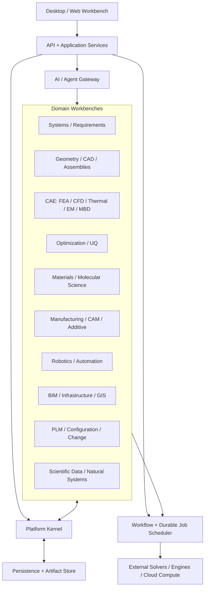

# Mono — Target Platform Architecture

**Status:** proposed architecture baseline for the refoundation branch.  
**Design principle:** one lifecycle platform, multiple truthful domain models.

## 1. Context map

Mono is a platform with domain workbenches, not a single monolithic physics engine.

The diagram shows logical boundaries. It does not imply all components must be separate deployable services.

## 2. Platform kernel

The kernel contains only concepts genuinely shared across disciplines.

### 2.1 Identity and lifecycle
- `Workspace`, `Project`, `Actor`, `Permission`
- `EngineeringSystem`, `ProductDefinition`, `DesignRevision`
- `Artifact`, `ArtifactRevision`, `Reference`, `Dependency`
- `AnalysisDefinition`, `ComputeJob`, `ResultSet`, `EvidenceRecord`
- `WorkflowInstance`, `Approval`, `ChangeRequest`, `ReleaseBaseline`

Every persistent object has a stable UUID, schema version, creation/update metadata and explicit ownership. Domain objects remain owned by their domain modules.

### 2.2 Quantities and units
A quantity is a value plus a dimension and unit, not a float with an informal unit label. Internal canonical units may use SI, but the API and file formats must preserve declared units. Conversions must be explicit, dimensionally checked and tested. Temperature requires distinction between absolute temperature and temperature difference. Angles, pressure, stress, energy, density, molar quantities and electromagnetic units must be dimensioned.

### 2.3 Coordinate frames
Use explicit named frames and transforms:
- frame ID, parent frame, handedness, axis convention;
- transform representation and units;
- validity and revision;
- transform provenance.

Never assume that a molecule's Ångström frame, a CAD millimetre frame, a robot base frame, a BIM georeferenced frame and a CFD domain frame can be mixed by multiplying a scalar.

### 2.4 Artifacts and provenance
An artefact is immutable content plus typed metadata. Store bytes by content hash; link them to domain revisions. Derived artefacts record:
- input artifact/revision IDs and hashes;
- transformation/solver/tool ID and exact version;
- configuration hash and parameter set;
- runtime environment, OS/architecture, backend and random seed where relevant;
- logs, warnings, exit status and resource use;
- parser/postprocessor version;
- verification, validation and approval evidence.

SHA-256 is an integrity primitive, not a signature or proof of origin.

## 3. Domain boundaries

### Geometry and CAD
Owns sketches, constraints, parametric feature history, B-Rep, mesh geometry, assemblies, tolerances and geometric references. CAD identity and topological naming require stable semantic references and explicit remapping after topology-changing operations.

### CAE and physics
Owns analysis definitions, discretization, materials, boundary/initial conditions, physics models, solver adapters, fields, convergence and verification. FEA, CFD, thermal, electromagnetics, acoustics and multibody dynamics are separate subdomains that may share job/provenance infrastructure.

### Optimization and uncertainty
Owns design variables, constraints, objectives, sampling plans, surrogate models, sensitivity, robust optimization, topology optimization and uncertainty. It orchestrates analyses but does not become a solver itself.

### Manufacturing
Owns process plans, machine definitions, tools, fixtures, stock, operations, toolpaths, postprocessors, process parameters, inspection and manufacturing evidence. G-code is a machine-targeted artefact, not a universal proof of manufacturability.

### Robotics
Owns robot models, joint limits, frames, forward/inverse kinematics, dynamics, trajectories, collision scene, controller and hardware adapters. Must not reuse a CAM toolpath as if it were a robot trajectory without transformation and validation.

### BIM / Infrastructure / Geospatial
Owns IFC entities, building systems, spatial references, georeferencing, infrastructure networks, terrain and GIS/raster/vector data. Coordinate reference systems and vertical datums are first-class.

### Materials and molecular science
Owns chemical identity, structures, composition, microstructure, constitutive models, force fields, thermodynamic states and experiment links. Molecular dynamics, docking, screening, materials informatics and lab validation remain separate workflows.

### PLM and systems engineering
Owns requirements, product configuration, variants, effectivity, change control, approvals, traceability, release baselines and digital thread. It references domain artefacts; it does not duplicate them.

### Scientific data and natural systems
Owns ingestion, catalogues, spatial/temporal datasets, metadata, quality, lineage, query, streaming and scientific compute. Earth/environmental systems require explicit spatial, temporal, uncertainty and scale semantics.

## 4. Contracts and adapters

Avoid a universal provider interface. Use narrow capability interfaces, for example:
- `GeometryKernel`: create/edit/query native geometry;
- `GeometryExchangeAdapter`: import/export STEP/IGES/mesh/etc.;
- `TessellationAdapter`: generate render meshes;
- `MeshAdapter`: inspect/convert computational meshes;
- `SolverAdapter`: prepare, execute, monitor and collect a solver run;
- `FieldDataAdapter`: read/write scalar/vector/tensor/time-dependent fields;
- `MolecularStructureAdapter`: parse, transform and export molecular structures;
- `ToolpathAdapter`: generate, inspect and post-process toolpaths;
- `BIMExchangeAdapter`: IFC import/export and validation;
- `RobotKinematicsAdapter`: kinematics and trajectory operations;
- `VisualizationAdapter`: expose a domain's data to appropriate renderers.

Contracts should be typed, versioned, capability-discoverable and testable with contract fixtures. A provider may implement multiple interfaces, but only those it can satisfy truthfully.

## 5. Persistence model

Use a relational database for metadata and transactional lifecycle, plus an artifact/object store for large immutable files. SQLite can support a local single-user profile initially; PostgreSQL is a natural multi-user target. The interface to persistence must not leak a database-specific model into domain logic.

Minimum persisted records:
- workspace/project and access control;
- domain object identity and revision;
- dependency graph;
- artifact metadata and object-store locator;
- analysis definition and exact input references;
- job state, attempts, worker identity and event log;
- result set and derived artifact references;
- evidence and approval records;
- schema migrations and audit events.

Do not store large meshes/trajectories as arbitrary JSON columns. Do not use in-memory global state as the source of truth.

## 6. Durable execution architecture

A job is an explicit entity with a state machine:

`DRAFT → VALIDATED → QUEUED → CLAIMED → RUNNING → COLLECTING → SUCCEEDED`

Failure paths include `REJECTED`, `FAILED`, `CANCEL_REQUESTED`, `CANCELLED`, `TIMED_OUT` and `LOST`. A process exit code alone does not determine scientific success.

Every job has:
- immutable input snapshot;
- worker image/runtime identity;
- resource request and hard quotas;
- unique scratch directory;
- cancellation and heartbeat;
- structured stdout/stderr/log artifacts;
- output allowlist and size quotas;
- result parser and verification stage;
- complete provenance record.

Local workers may use subprocesses first. Untrusted user code requires stronger OS isolation. Container, sandbox, VM or remote worker choices are deployment decisions; “native only” is not a security requirement.

## 7. AI and agent architecture

AI is a planning and assistance layer, never a numerical authority.

Flow:
1. Parse user intent and identify discipline.
2. Produce a schema-validated proposed specification.
3. Check capabilities, units, inputs and constraints.
4. Ask for clarification/approval where ambiguity or consequence requires it.
5. Generate a declarative plan or solver input.
6. Run deterministic validation.
7. Submit an authorized job.
8. Explain results with citations to raw evidence and limitations.
9. Require qualified human approval for release/manufacture/regulated decisions.

Use provider abstraction for model APIs; enforce per-tool scopes, prompt-injection boundaries, cost/latency limits, audit logs and human confirmation. Model-generated code is untrusted input.

## 8. Visualization architecture

A shared shell can host specialized viewers:
- B-Rep/mesh viewport;
- engineering drawings and GD&T;
- scalar/vector/tensor/volume fields;
- time-dependent transient results;
- molecular structure and trajectory;
- BIM/GIS and geospatial data;
- robot trajectories and collision scene;
- manufacturing toolpaths and machine envelope.

Transport contracts must carry coordinate frames, units, topology, field association (node/cell/point), time index, component names, validity masks and schema version. Rendering is not validation.

## 9. Deployment topology

Start with:
- desktop shell + local API;
- modular monolith for application/domain logic;
- relational local database;
- local artifact store;
- isolated compute worker processes;
- optional remote worker adapter.

Add distributed queue, object storage, collaboration services and cloud execution only when measured requirements justify them. Keep domain boundaries stable so extraction remains possible.

## 10. Cross-cutting acceptance gates

No feature is complete without:
- domain schema and migration;
- unit/dimension/frame tests;
- import/export round-trip tests;
- deterministic contract tests;
- persistence/restart tests;
- security/fuzz/resource-limit tests where applicable;
- provenance completeness;
- failure-state coverage;
- performance measurements with hardware/software context;
- solver benchmarks and VVUQ evidence for physical calculations.
